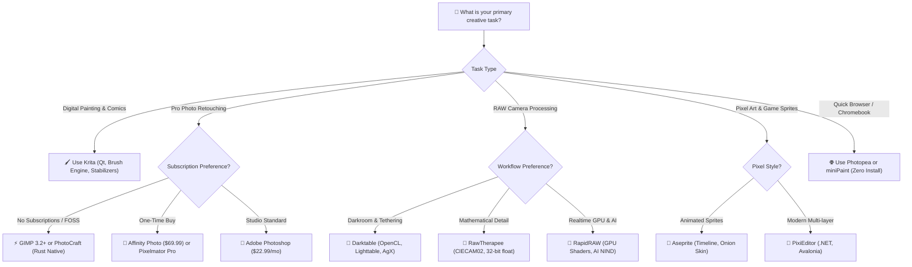

<p align="center">
  
</p>

# 🎨 Awesome Raster Graphics & Photo Editing Software

<p align="center">
  <a href="https://github.com/ishandutta2007/Awesome-Awesome-Awesome"></a>
  <a href="https://discord.gg/jc4xtF58Ve"></a>
  <a href="https://github.com/ishandutta2007/Awesome-Raster-Graphics-Photo-Editing-Software/stargazers"></a>
  <a href="https://github.com/ishandutta2007/Awesome-Raster-Graphics-Photo-Editing-Software/network/members"></a>
  <a href="https://github.com/ishandutta2007/Awesome-Raster-Graphics-Photo-Editing-Software/pulls"></a>
  <a href="https://github.com/ishandutta2007/Awesome-Raster-Graphics-Photo-Editing-Software/blob/main/LICENSE"></a>
  <a href="https://github.com/ishandutta2007"></a>
</p>

> **A definitive, SEO-optimized directory of top-tier raster graphics editors, image manipulation suites, digital painting software, and RAW photo processing platforms.**  
> *Covering industry-standard SaaS suites, desktop powerhouses, and high-performance open-source (FOSS) alternatives with layer compositing, non-destructive editing, and GPU acceleration.*

---

## 📑 Table of Contents

- [🌐 Sector Overview & Market Dynamics](#-sector-overview--market-dynamics)
- [🏢 SaaS & Commercial Platforms](#-saas--commercial-platforms)
  - [📊 SaaS Platforms Comparison Table](#-saas-platforms-comparison-table)
  - [🔍 Detailed SaaS Profiles](#-detailed-saas-profiles)
- [🔓 Open-Source GitHub Projects](#-open-source-github-projects)
  - [⭐ Open-Source Projects Ranked by Stars](#-open-source-projects-ranked-by-stars)
  - [🔬 Deep Dive into Open-Source Solutions](#-deep-dive-into-open-source-solutions)
- [⚖️ Feature & Architecture Matrix](#-feature--architecture-matrix)
- [🎯 Choosing the Right Editor for Your Workflow](#-choosing-the-right-editor-for-your-workflow)
- [🤝 How to Contribute](#-how-to-contribute)
- [💖 Support](#-support)
- [⭐ Star History](#-star-history)
- [📄 License & Disclaimer](#-license--disclaimer)

---

## 🌐 Sector Overview & Market Dynamics

The global raster graphics and photo editing software market was valued at approximately **$1.35 billion in 2024** and is projected to expand to **over $2.45 billion by 2031**, progressing at a Compound Annual Growth Rate (CAGR) of **~7.5%**, driven by cross-platform GPU pipelines, content-creator growth, and generative AI enhancement.

The market displays a **bifurcated structure featuring an entrenched, winner-takes-most enterprise tier paired with a moderately fragmented prosumer and indie tier**:
- **Enterprise & Creative Studios (Concentrated / Winner-Takes-Most)**: Adobe Photoshop controls an estimated 75%–80% of professional studio pipelines due to decades of deep `.psd` standardisation, prepress CMYK printing color management, and agency collaboration workflows.
- **Prosumer, Indie & Web-Native Tiers (Moderately Fragmented)**: Canva's acquisition of Affinity Photo, Apple's acquisition of Pixelmator Pro, and lightweight client-side WebGL applications such as Photopea have captured significant market share from creators seeking non-subscription perpetual licenses or browser-based agility.
- **Open-Source Vanguard (Decentralized & Accelerating)**: Modern FOSS powerhouses—including GIMP 3.2+ (introducing non-destructive link layers and vector layers), Krita 5.3+ (digital painting), and Rust-native engines like PhotoCraft—offer privacy-first, telemetry-free, high-fidelity daily drivers.

---

## 🏢 SaaS & Commercial Platforms

Commercial photo editors and raster graphics suites provide mature typography engines, deep plugin ecosystems, and cloud workflow integrations.

### 📊 SaaS Platforms Comparison Table

*Sorted descending by company size / revenue / valuation:*

| 🏢 Platform | 📊 Company Valuation / Scale | 💳 Starting Pricing | 🎁 Free Tier & Trial Limits | 🎯 Primary Focus | 💻 Platforms |
| :--- | :--- | :--- | :--- | :--- | :--- |
| **[Adobe Photoshop](https://www.adobe.com/products/photoshop.html)** | **Adobe Inc.**<br>~$200B+ Market Cap<br>~$21.4B Annual Revenue | **$22.99 / month**<br>(Single App plan)<br>or **$19.99 / mo** (Photography 20GB plan) | **7-day free trial** with full access to all desktop features, neural filters, and 100GB Creative Cloud storage; credit card required to start, converts to paid unless cancelled before day 7. No permanent free tier. | Industry-standard layer compositing, retouching, masking, prepress CMYK & plugin ecosystem | Windows, macOS, iPadOS, Web (light) |
| **[Affinity Photo](https://affinity.serif.com/photo/)** | **Canva** (acquired Serif)<br>~$26B Valuation<br>~$2.6B ARR | **$69.99 one-time**<br>perpetual license<br>*(or $164.99 Universal V2 Suite)* | **30-day free trial** with 100% full feature access, unwatermarked high-res exports, and no credit card required. 100% free permanent license for qualified schools, teachers, and non-profits. | Professional non-destructive live filters, RAW processing, focus stacking, HDR merge & PSD roundtrip | Windows, macOS, iPadOS *(no Linux)* |
| **[Corel PaintShop Pro](https://www.paintshoppro.com/)** | **Alludo / KKR**<br>~$1B+ Private Valuation<br>~$250M - $300M Revenue | **$79.99 one-time**<br>perpetual license<br>*(Ultimate Edition at $99.99)* | **30-day free trial** with full raster editing, RAW camera lab, and local file saving; no credit card required. Trial watermark applies only to bundled third-party plugins. | Photoshop alternative for Windows users, comprehensive raster/vector tools, AI upsampling | Windows only |
| **[Capture One Pro](https://www.captureone.com/)** | **Capture One A/S** (Axcel PE)<br>~$400M Valuation<br>~$60M - $70M ARR | **$24.00 / month**<br>(or $179.00/yr billed annually)<br>or **$299.00 one-time** perpetual | **30-day free trial** with unrestricted tethered shooting, color balance wheels, non-destructive layer masks, and batch RAW exports; no credit card required. | High-end studio photography, live camera tethering, color grading wheels, and RAW conversion | Windows, macOS, iPadOS |
| **[Pixlr](https://pixlr.com/)** | **Inmagine Group**<br>~$50M+ Annual Revenue | **$1.99 / month**<br>(Plus plan, $23.88/yr)<br>or **$7.99 / mo** (Premium) | **Free-forever tier** includes standard resolution canvas, layer editing, and basic adjustment filters, strictly limited to **3 daily file saves/exports** with banner ads; 7-day free trial for Premium. | Lightweight cloud-first raster photo editing with quick AI cutout and social media presets | Web (Chrome, Firefox, Safari), iOS, Android |
| **[Pixelmator Pro](https://www.pixelmator.com/pro/)** | **Pixelmator Team / Apple**<br>Acquired by Apple (~$3.5T MCap)<br>~$20M ARR studio | **$49.99 one-time**<br>perpetual purchase via Mac App Store | **7-day free trial** downloaded from official website with complete feature availability, unlimited saves, and Core ML acceleration; no credit card required. | Apple-native design, deep Metal GPU acceleration, Core ML super-resolution and denoise, SVG & PSD support | macOS, iPadOS |
| **[Fotor](https://www.fotor.com/)** | **Everimaging Ltd.**<br>~$20M - $30M Annual Revenue | **$3.33 / month**<br>($39.99 billed annually)<br>or **$8.99 / mo** (Monthly Pro) | **Free-forever plan** with basic photo adjustments, standard collage templates, 500MB cloud sync, and low-res/watermarked AI background remover; 3-day free trial on Pro features. | Consumer-friendly cloud photo enhancement, batch resizing, portrait retouching, and quick templates | Web, Windows, macOS, iOS, Android |
| **[Photopea](https://www.photopea.com/)** | **Photopea (Ivan Kutskir)**<br>Bootstrapped Sole Creator<br>~$1.5M - $2.5M ARR | **$5.00 / month**<br>(Single User ad-free)<br>or **$15 / 3 mo**, **$40 / yr** | **Free-forever plan** containing 100% full feature availability (PSD, PSB, AI, Sketch, PDF, RAW editing) funded by sidebar advertisements, limited to **30 history undo steps** (vs 60 on Premium) and **0.5 GB cloud Peadrive storage**. | High-fidelity web clone of Photoshop running client-side via JavaScript & WebGL; opens PSD/PSB files instantly | Web (any browser), PWA (Desktop & Mobile) |

---

### 🔍 Detailed SaaS Profiles

#### 1. [Adobe Photoshop](https://www.adobe.com/products/photoshop.html)
- 🏷️ **Category**: Enterprise Professional Raster Editor
- 💡 **Highlights**: Layer-based compositing, non-destructive smart objects, generative fill, comprehensive CMYK color separation, channel operations, and hundreds of battle-tested third-party plugins.
- ⚠️ **Trade-offs**: Mandatory subscription model, resource-heavy installation, and proprietary cloud dependencies.
- 🎯 **Best For**: Creative agency professionals, prepress production houses, and retouching studios requiring flawless `.psd` interoperability.

#### 2. [Affinity Photo](https://affinity.serif.com/photo/)
- 🏷️ **Category**: Professional Perpetual Raster Suite
- 💡 **Highlights**: High-performance multi-threaded engine, real-time live adjustment layers, 32-bit HDR workflows, focus stacking, panorama stitching, and full PSD import/export. Free for educational institutions and non-profits.
- ⚠️ **Trade-offs**: No native GNU/Linux build; smaller third-party plugin ecosystem than Adobe.
- 🎯 **Best For**: Designers and photographers on macOS, Windows, and iPad desiring professional power without recurring subscriptions.

#### 3. [Corel PaintShop Pro](https://www.paintshoppro.com/)
- 🏷️ **Category**: Consumer & Prosumer Desktop Suite
- 💡 **Highlights**: Comprehensive raster editing with integrated vector tools, AI-assisted upsampling, camera RAW lab, and perpetual single-purchase licensing.
- ⚠️ **Trade-offs**: Windows exclusive; user interface exhibits legacy inconsistencies across legacy and modern dialogs.
- 🎯 **Best For**: Windows hobbyists, photo clubs, and small business operators wanting a one-off perpetual Photoshop alternative.

#### 4. [Capture One Pro](https://www.captureone.com/)
- 🏷️ **Category**: Studio Photography & RAW Grading
- 💡 **Highlights**: Industry-standard tethered camera shooting, ultra-precise color balance wheels, non-destructive parametric adjustment layers, and customizable studio workspaces.
- ⚠️ **Trade-offs**: High price point; tailored specifically for photography development rather than pixel-level illustration or compositing.
- 🎯 **Best For**: Commercial fashion, studio, and product photographers requiring reference color rendering and tethering.

#### 5. [Photopea](https://www.photopea.com/)
- 🏷️ **Category**: Zero-Install Web Raster Editor
- 💡 **Highlights**: Executes completely in the browser via WebGL and WebAssembly without sending pixel data to servers. Native support for `.psd`, `.psb`, `.ai`, `.sketch`, and `.xcf`.
- ⚠️ **Trade-offs**: Free tier displays sidebar advertisements; history stack capped at 30 steps on free tier.
- 🎯 **Best For**: Chromebook users, students, quick edits on shared workstations, and users seeking Photoshop muscle memory without local installations.

---

## 🔓 Open-Source GitHub Projects

Explore the finest open-source raster graphics engines, pixel art editors, and RAW processors. Every project listed here respects user privacy, is free from telemetric tracking, and enables custom builds and automation.

### ⭐ Open-Source Projects Ranked by Stars

*Sorted descending by GitHub stargazers count:*

| 🏅 Rank | 📦 Project & Repository | 🌟 Star Badge | 📜 License | 🛠️ Core Stack | 🎯 Primary Focus |
| :---: | :--- | :---: | :---: | :---: | :--- |
| **1** | **[PhotoCraft](https://github.com/storytold/photocraft)** | [](https://github.com/storytold/photocraft/stargazers) | MIT / Apache-2.0 | Rust, WebGPU, Vulkan, Metal | High-performance Rust-native Photoshop alternative with 134/135 PSD roundtrip fidelity |
| **2** | **[Aseprite](https://github.com/aseprite/aseprite)** | [](https://github.com/aseprite/aseprite/stargazers) | EULA / Source-Available | C++, Skia | Animated sprite editor & pixel art tool with timeline, onion skinning & palette shading |
| **3** | **[Darktable](https://github.com/darktable-org/darktable)** | [](https://github.com/darktable-org/darktable/stargazers) | GPL-3.0 | C, OpenCL, GTK3 | Non-destructive RAW photo developer, virtual lighttable, and colorimetric image pipeline |
| **4** | **[RapidRAW](https://github.com/CyberTimon/RapidRAW)** | [](https://github.com/CyberTimon/RapidRAW/stargazers) | GPL-3.0 | C++, GPU Shaders, AI NIND | Real-time GPU-accelerated RAW editor with AI denoising, vectorscopes & modern export formats |
| **5** | **[Krita](https://github.com/KDE/krita)** | [](https://github.com/KDE/krita/stargazers) | GPL-3.0 | C++, Qt5/Qt6, OpenGL | World-class digital painting and raster illustration suite with brush stabilizers & wrap-around mode |
| **6** | **[PixiEditor](https://github.com/PixiEditor/PixiEditor)** | [](https://github.com/PixiEditor/PixiEditor/stargazers) | MIT | C#, .NET, Avalonia UI | Lightweight, modern pixel art and raster graphics editor with multi-layer blend modes |
| **7** | **[GIMP](https://github.com/GNOME/gimp)** | [](https://github.com/GNOME/gimp/stargazers) | GPL-3.0 | C, GEGL, GTK3, Python 3 | The reference FOSS image manipulation program featuring non-destructive link & vector layers |
| **8** | **[RawTherapee](https://github.com/RawTherapee/RawTherapee)** | [](https://github.com/RawTherapee/RawTherapee/stargazers) | GPL-3.0 | C++, GTK3, OpenMP | High-precision 32-bit floating-point RAW processing engine featuring CIECAM02 color modeling |
| **9** | **[Pinta](https://github.com/PintaProject/Pinta)** | [](https://github.com/PintaProject/Pinta/stargazers) | MIT | C#, .NET, GTK3 | Simple, responsive raster drawing and photo editing modeled after Paint.NET |
| **10** | **[miniPaint](https://github.com/viliusle/miniPaint)** | [](https://github.com/viliusle/miniPaint/stargazers) | MIT | JavaScript, HTML5 Canvas | Zero-installation, fully client-side open-source browser photo editor with layers & filters |
| **11** | **[MyPaint](https://github.com/mypaint/mypaint)** | [](https://github.com/mypaint/mypaint/stargazers) | GPL-2.0 | Python, C++, GTK3 | Distraction-free raster painting tool with an infinite canvas and dynamic brush physics |
| **12** | **[PhotoDemon](https://github.com/tannerhelland/PhotoDemon)** | [](https://github.com/tannerhelland/PhotoDemon/stargazers) | BSD-2-Clause | Visual Basic 6, C DLLs | 100% portable Windows photo editor with 200+ pro tools, macro recording & zero dependencies |

---

### 🔬 Deep Dive into Open-Source Solutions

#### 1. [PhotoCraft](https://github.com/storytold/photocraft) — *The Rust-Native Photoshop Contender*
- 🌟 **Star Badge**: [](https://github.com/storytold/photocraft/stargazers)
- 🚀 **Architecture**: Written from scratch in memory-safe Rust with multi-backend hardware rendering (Vulkan, Metal, DirectX 12, WebGPU).
- ✨ **Key Features**:
  - Unprecedented PSD/PSB roundtrip fidelity (134 of 135 benchmark test suites maintaining zero delta visual parity).
  - Layer styles, adjustment layers, text engines, channel clipping masks, and vector paths.
  - Native ICC color management across RGB, CMYK, Lab, and 8/16/32-bit floating point buffers.
- 🎯 **Best For**: Early adopters seeking a blazing-fast, crash-resilient native Linux/macOS/Windows alternative to Adobe Photoshop.

#### 2. [Aseprite](https://github.com/aseprite/aseprite) — *The Standard in Pixel Art & Sprite Animation*
- 🌟 **Star Badge**: [](https://github.com/aseprite/aseprite/stargazers)
- 🚀 **Architecture**: High-performance C++ rendering pipeline powered by Google Skia.
- ✨ **Key Features**:
  - Frame-by-frame raster timeline with real-time onion skinning and animation tagging.
  - Palette color quantization, color wheel harmony adjustments, and shading ink modes.
  - CLI headless automation for batch rendering sprite sheets and texture atlases in CI/CD pipelines.
- 🎯 **Best For**: Indie game developers, sprite animators, pixel artists, and game jam participants.

#### 3. [Darktable](https://github.com/darktable-org/darktable) — *Virtual Lighttable & Non-Destructive Darkroom*
- 🌟 **Star Badge**: [](https://github.com/darktable-org/darktable/stargazers)
- 🚀 **Architecture**: OpenCL hardware acceleration with modular 32-bit floating-point processing pipes.
- ✨ **Key Features**:
  - Non-destructive parametric and drawn masks with scene-referred color grading workflows (Filmic RGB / AgX).
  - Comprehensive database cataloging for digital negatives with fast sorting and rating.
  - Advanced sensor-specific demosaicing, chromatic aberration correction, and lens profile matching.
- 🎯 **Best For**: Professional photographers seeking a full Lightroom alternative on Linux, macOS, and Windows.

#### 4. [RapidRAW](https://github.com/CyberTimon/RapidRAW) — *Next-Gen GPU-Accelerated RAW Processor*
- 🌟 **Star Badge**: [](https://github.com/CyberTimon/RapidRAW/stargazers)
- 🚀 **Architecture**: Direct GPU shader compute pipeline delivering instant viewport feedback.
- ✨ **Key Features**:
  - Integrated AI NIND (Neural Image Noise Denoising) and subject segmentation models.
  - Real-time broadcast-grade image analytics: vectorscopes, RGB waveforms, and parade scopes.
  - First-class support for modern compressed image standards: JPEG XL, AVIF, and WebP.
- 🎯 **Best For**: Tech-forward photographers wanting instantaneous response times on modern GPU hardware.

#### 5. [Krita](https://github.com/KDE/krita) — *The Creative Painting & Concept Art Workhorse*
- 🌟 **Star Badge**: [](https://github.com/KDE/krita/stargazers)
- 🚀 **Architecture**: Qt-based UI with OpenGL canvas acceleration and multi-core brush computation.
- ✨ **Key Features**:
  - Industry-leading brush engine with 9 distinct brush engines, smoothing stabilizers, and dynamic resource management.
  - Seamless 'W' key wrap-around mode for 3D texture artists and pattern designers.
  - Full OpenType typography engine with on-canvas text manipulation and PSD text layer interoperability.
- 🎯 **Best For**: Concept artists, digital painters, illustrators, comic/manga creators, and texture painters.

#### 6. [PixiEditor](https://github.com/PixiEditor/PixiEditor) — *Modern & Fluid Pixel Art Studio*
- 🌟 **Star Badge**: [](https://github.com/PixiEditor/PixiEditor/stargazers)
- 🚀 **Architecture**: Built on C#, .NET, and Avalonia UI for clean cross-platform performance.
- ✨ **Key Features**:
  - Fluid canvas navigation, pixel-perfect pencil tool, line & shape rasterizers.
  - Unlimited layers with blend modes, masking, and animation timeline scrubbers.
  - Custom color palettes, hex inputs, and extensible C# plugin ecosystem.
- 🎯 **Best For**: Digital creators wanting a sleek, modern desktop pixel art experience without legacy UI clutter.

#### 7. [GIMP (GNU Image Manipulation Program)](https://github.com/GNOME/gimp) — *The Open-Source Vanguard*
- 🌟 **Star Badge**: [](https://github.com/GNOME/gimp/stargazers)
- 🚀 **Architecture**: Built on the Generic Graphics Library (GEGL) graph processing engine with GTK3.
- ✨ **Key Features**:
  - **Non-Destructive Link Layers**: Automatically updates compositions when external linked raster assets are modified on disk.
  - **Vector Layers via Path Tool**: Scalable bezier shapes with adjustable strokes and fills natively within raster compositions.
  - Extensive multi-language scripting support (Python 3, C, C++, Scheme / Script-Fu).
- 🎯 **Best For**: Graphic designers, students, web designers, and GNU/Linux power users requiring a battle-tested raster suite.

#### 8. [RawTherapee](https://github.com/RawTherapee/RawTherapee) — *Parametric Color Science RAW Engine*
- 🌟 **Star Badge**: [](https://github.com/RawTherapee/RawTherapee/stargazers)
- 🚀 **Architecture**: Multi-threaded 32-bit floating-point processing pipeline using OpenMP.
- ✨ **Key Features**:
  - High-end demosaicing algorithms (AMaZE, RCD, DCB, LMMSE) for maximum sensor detail extraction.
  - CIECAM02 human visual perception color appearance modeling.
  - Dual-demosaic mode resolving both high-frequency noisy backgrounds and smooth gradients simultaneously.
- 🎯 **Best For**: Scientific, astro, and landscape photographers desiring mathematical color purity and fine grain control.

#### 9. [Pinta](https://github.com/PintaProject/Pinta) — *Simple, Responsive Painting & Retouching*
- 🌟 **Star Badge**: [](https://github.com/PintaProject/Pinta/stargazers)
- 🚀 **Architecture**: Clean C# codebase utilizing GTK3 for cross-platform Linux, Mac, and Windows consistency.
- ✨ **Key Features**:
  - Straightforward Paint.NET-inspired layout with full layer composition capabilities.
  - Over 35 adjustment effects (levels, hue/saturation, curves, blurs, and oil painting filters).
  - Unlimited undo history with low memory footprint and rapid startup times.
- 🎯 **Best For**: Casual editors, rapid screenshot annotations, and everyday photo crop/retouch tasks.

#### 10. [miniPaint](https://github.com/viliusle/miniPaint) — *Zero-Install HTML5 Client-Side Canvas Editor*
- 🌟 **Star Badge**: [](https://github.com/viliusle/miniPaint/stargazers)
- 🚀 **Architecture**: Pure client-side JavaScript leveraging HTML5 2D Canvas APIs with zero server requirements.
- ✨ **Key Features**:
  - Multi-layer support with alpha blending, color adjustments, and image warping filters.
  - Complete privacy: images are rendered in local browser memory and never uploaded to any remote server.
  - Self-hostable as a single static bundle on GitHub Pages, Cloudflare Pages, or Docker.
- 🎯 **Best For**: Quick browser-based edits, embedded web apps, and privacy-conscious users on restricted networks.

#### 11. [MyPaint](https://github.com/mypaint/mypaint) — *Infinite Canvas for Tablet Illustrators*
- 🌟 **Star Badge**: [](https://github.com/mypaint/mypaint/stargazers)
- 🚀 **Architecture**: Modular `libmypaint` brush engine in C paired with Python GTK user interface.
- ✨ **Key Features**:
  - Frictionless, borderless infinite canvas that expands dynamically as you sketch.
  - Highly expressive brush engine simulating charcoal, oils, inks, and water-wash pigments.
  - Full graphics tablet stylus sensitivity support (pressure, tilt, and barrel rotation).
- 🎯 **Best For**: Expressive concept sketching, rapid ideation, and digital artists using drawing tablets.

#### 12. [PhotoDemon](https://github.com/tannerhelland/PhotoDemon) — *Ultra-Portable Windows Powerhouse*
- 🌟 **Star Badge**: [](https://github.com/tannerhelland/PhotoDemon/stargazers)
- 🚀 **Architecture**: Highly optimized native Windows binary with zero external runtime or .NET dependencies.
- ✨ **Key Features**:
  - Over 200 professional-grade tools packed into a portable executable under 30 MB.
  - Multi-layer compositing, comprehensive ICC color management, non-destructive selection masks, and batch macro recorder.
  - Runs directly from USB flash drives without registry modifications or administrative rights.
- 🎯 **Best For**: Windows system administrators, IT toolkits, field laptops, and users requiring a portable editor.

---

## ⚖️ Feature & Architecture Matrix

| Feature / Capability | GIMP 3.2+ | Krita 5.3+ | PhotoCraft | Darktable | Adobe Photoshop | Affinity Photo | Photopea |
| :--- | :---: | :---: | :---: | :---: | :---: | :---: | :---: |
| **Open Source (FOSS)** | ✅ Yes (GPL) | ✅ Yes (GPL) | ✅ Yes (MIT/Apache) | ✅ Yes (GPL) | ❌ Proprietary | ❌ Proprietary | ❌ Proprietary |
| **Licensing Model** | Free Forever | Free Forever | Free Forever | Free Forever | $22.99/mo Sub | $69.99 Perpetual | Free / $5.00/mo |
| **Primary Domain** | Image Manipulation | Digital Painting | Layer Compositing | RAW Photo Dev | Full Creative Suite | Photo Retouching | Web PSD Editing |
| **GPU Acceleration** | GEGL / OpenCL | OpenGL | Vulkan / Metal / DX12 | OpenCL | Mercury Graphics | Multi-Core / GPU | WebGL |
| **PSD Roundtrip Fidelity** | Moderate | Partial (Text/Layers) | Near Flawless (134/135) | Import Only | Native (Reference) | High | High |
| **Non-Destructive Layers** | ✅ (Link/Vector) | ✅ (Filter/Vector) | ✅ (Adjustments) | ✅ (Parametric) | ✅ (Smart Objects) | ✅ (Live Filters) | ✅ (Smart Objects) |
| **RAW Camera Engine** | Via Darktable/UFRaw | Basic | In Development | State-of-the-art | Adobe Camera Raw | Built-in Serif RAW | Libraw WebAssembly |
| **Linux Support** | ✅ First-Class | ✅ First-Class | ✅ First-Class | ✅ First-Class | ❌ No | ❌ No | ✅ Via Browser |

---

## 🎯 Choosing the Right Editor for Your Workflow



---

## 🤝 How to Contribute

Contributions from the global creative and developer community are warmly appreciated!

1. 🍴 **Fork the Repository**: Click the **Fork** button at the top right of this page.
2. 🌿 **Create a Feature Branch**:
   ```bash
   git checkout -b feature/add-new-raster-tool
   ```
3. 📝 **Add Your Entry**: Ensure SaaS tools include explicit starting prices, free tier limits, and valuation. Open-source entries must feature an official GitHub star badge linking to `/stargazers`.
4. ✅ **Verify Formatting**: Keep table markdown aligned and URLs functional.
5. 🚀 **Submit a Pull Request**: Detail the rationale for your addition and verify all links.

---

## 💖 Support

If you found this curated ecosystem directory helpful, consider supporting the maintenance and continuous updates of this project:

- ⭐ **Star this repository** to improve discoverability for other creators.
- 🍴 **Fork and share** with fellow designers, illustrators, and photographers.
- ☕ **Sponsor the Maintainer**: Support ongoing open-source curation via the [GitHub Sponsor Dashboard](https://github.com/sponsors/ishandutta2007).

Your backing ensures this repository remains up-to-date with emerging tools, benchmarks, and ecosystem shifts!

---

## ⭐ Star History

[](https://star-history.dera.page/#ishandutta2007/Awesome-Raster-Graphics-Photo-Editing-Software&type=date&legend=top-left)

---

## 📄 License & Disclaimer

- Distributed under the [MIT License](LICENSE).
- All third-party trademarks, product names, company logos, and brand assets are the property of their respective owners. Mention within this community-curated directory is for informational purposes only and does not constitute an endorsement.
